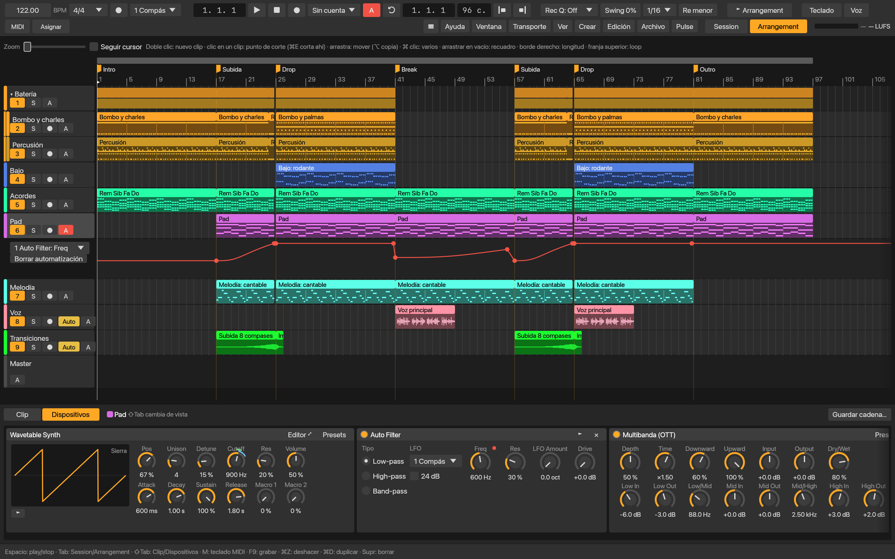
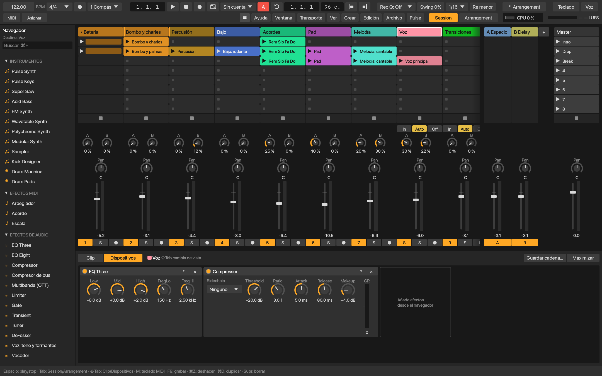
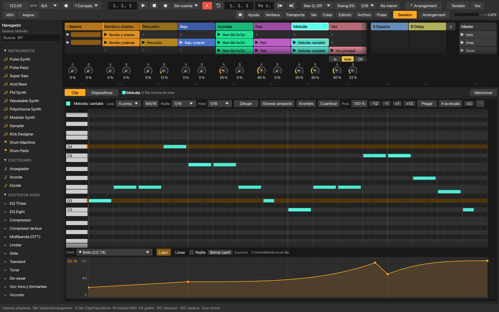
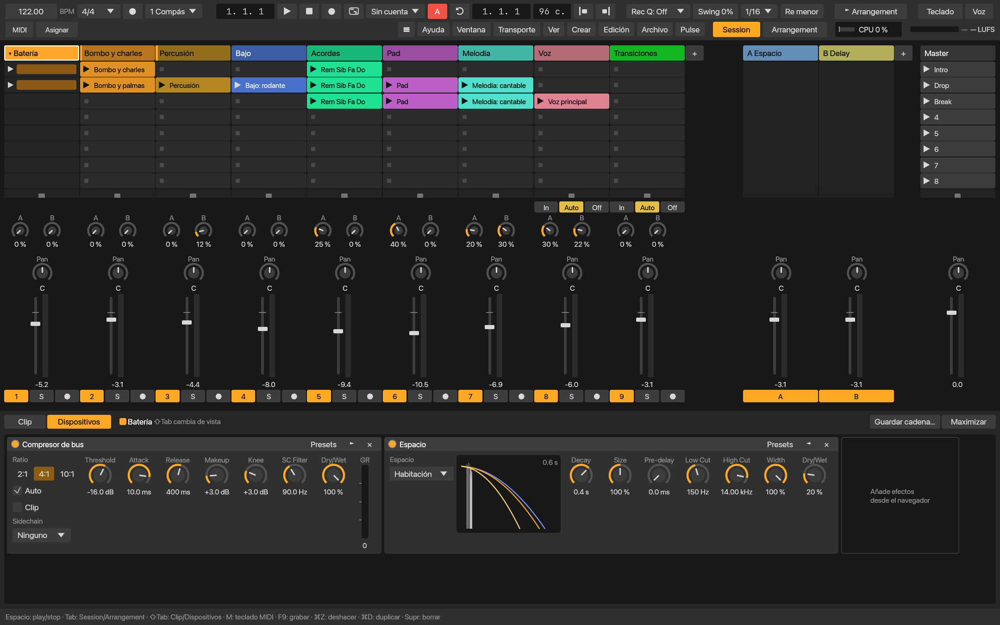
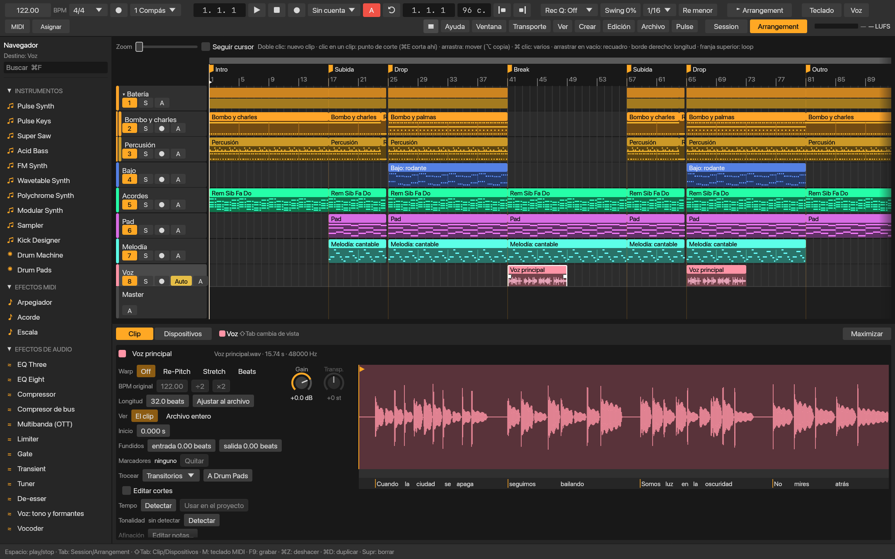
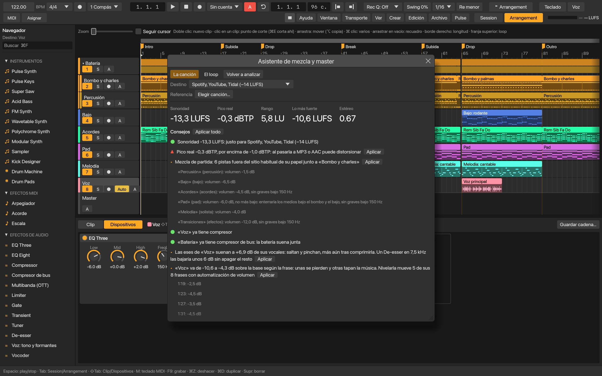

# Pulse

**Español** · [English](README.en.md)

Pulse es un DAW (estación de trabajo de audio digital) para hacer música
electrónica de principio a fin: componer, grabar, producir, mezclar, masterizar
y exportar. Está escrito desde cero en Rust (cpal para el audio, egui para la
interfaz) y es software libre (GPL-3.0-or-later).

Tiene lo que se espera de un DAW —Session y Arrangement, piano roll, mezclador,
instrumentos, efectos y plugins— y añade herramientas que hacen parte del
trabajo por ti: convertir audio en MIDI, escribir acordes, bajos y melodías que
encajan con tu canción, transcribir la letra de una voz o mezclar y masterizar
con un asistente. Todo corre en tu ordenador, sin conexión y sin cuentas.



*El Arrangement: un tema completo con sus secciones, clips MIDI y de audio, transiciones y la automatización del filtro.*

La primera vez, Pulse pregunta **¿Qué quieres hacer?**: escuchar su canción de
ejemplo, empezar de una plantilla por género (house, techno, trap, reggaetón,
pop, lo-fi, drum & bass, podcast), tararear una idea, remezclar una canción o
seguir una de sus **lecciones** paso a paso, que se marcan solas al hacerlas.

## Qué puedes hacer

**Componer**
- Session View con clips y escenas lanzados en tiempo, y Arrangement con
  tomas, comping, transiciones, automatización y arreglo automático por
  secciones (intro, subida, drop, break, salida).
- Editor MIDI con escala, acordes, cuantización y groove. Pitch bend, rueda,
  aftertouch y cualquier CC se graban y se editan en carriles del clip.
- Tonalidad del proyecto, acordes por grados y **Acompañar**: bajos (raíz,
  octavas, contratiempo, caminante, rodante, galope), arpegios, pads, stabs y
  **melodías** (gancho, cantable, lead de trance, pregunta y respuesta) que
  siguen los acordes de un clip.
- **Generar ritmo** en el estilo que elijas (house, techno, trap, reggaetón…),
  escrito o tocado por una IA de batería.
- **De tarareo a canción**: tararea una melodía y Pulse la armoniza y le pone
  batería, bajo y acordes.

**Voz y audio**
- **Audio a MIDI** de voces (pYIN) e instrumentos o acordes (Basic Pitch).
- **Afinar una voz nota a nota**, separar una canción en **stems** (HTDemucs) y
  seguir el tempo de cualquier audio (Beat This!).
- **Transcribir la letra** de una voz con sus tiempos (Whisper), corregirla a
  mano y exportarla como .txt o .lrc.
- **Tocar con la voz**: canta, tararea o haz beatbox en el micrófono y una
  pista lo toca como un teclado MIDI.

**Sonido**
- Instrumentos propios: Pulse Synth, Super Saw, Acid Bass, FM Synth,
  Wavetable, Polychrome, Modular, Pulse Keys (piano, pianos eléctricos y
  órgano), Sampler, Kick Designer, Drum Machine y Drum Pads, con cientos de
  presets de fábrica.
- **Sonidos de Pulse**: kits de batería por género y sonidos sueltos, hechos
  por Pulse sin samples de terceros.
- 22 efectos, entre ellos EQ de 8 bandas, compresor, **compresor de bus**,
  **multibanda (OTT)**, limitador, saturador, de-esser, reverb de convolución
  **Espacio**, delay, chorus, phaser, **Vocoder** y **Voz: tono y formantes**.
- Cadenas de efectos guardables y plugins **VST3 y CLAP** con sus editores.

**Mezclar y terminar**
- Mezclador con grupos, retornos, sidechain (también en un clic desde el
  bombo) y compensación de latencia.
- **Asistente de mezcla y master**: mide la mezcla, explica lo que ve y, si
  quieres, la equilibra, le hace sitio a cada pista y la lleva a la sonoridad
  de streaming, Apple Music, club, hard techno, radio y TV, o la de una
  canción de referencia.
- Exportación a WAV, stems por pista y archivos MIDI; importación de sets de
  Ableton Live (`.als`).
- Versiones del proyecto, autoguardado y recuperación tras un cierre
  inesperado.

**Motor**
- Audio en tiempo real sin bloqueos ni reservas de memoria en el hilo de
  audio, repartido entre varios núcleos. Suena igual con cualquier tamaño de
  buffer y cualquier número de hilos, y lo comprueban las pruebas.

Todo está explicado en la **guía**, [`docs/guia.md`](docs/guia.md), que la app
muestra en Ayuda → Guía de Pulse (con buscador). Cada función nueva se añade a
la guía en el mismo pull request.

## Capturas



*La Session: clips y escenas para improvisar, con el mezclador, los envíos y los retornos de Espacio y Delay.*



*El piano roll: una melodía escrita por Acompañar sobre los acordes, con su carril de expresión (brillo).*



*Los dispositivos: el bus de batería con el Compresor de bus y la reverb de convolución Espacio.*



*El editor de audio: la voz con su letra transcrita, palabra a palabra, bajo la forma de onda.*



*El asistente de mezcla y master: mide sonoridad, picos y estéreo, y propone cambios que aplicas con un clic.*

Las capturas salen de un proyecto de ejemplo que monta una prueba, sin abrir la app. Se regeneran con `cargo test --release -p app readme_shots -- --ignored`.

## Sistemas

- **macOS** 13.4 o posterior en Apple Silicon: [instalar](docs/INSTALL_MACOS.md).
- **Windows** 10/11 x64, aún sin verificar en un equipo real:
  [compilar](docs/BUILD_WINDOWS.md), [instalar](docs/INSTALL_WINDOWS.md) y
  [estado](docs/WINDOWS_SUPPORT.md).

Qué funciona en cada uno: [`docs/PLATFORM_SUPPORT.md`](docs/PLATFORM_SUPPORT.md).
La app se actualiza sola desde las publicaciones de GitHub, que van firmadas.

## Compilar y ejecutar

```bash
cargo run --release
```

Los proyectos se guardan como `.pulse` (JSON). `cargo test --release` ejecuta
las pruebas, que no necesitan tarjeta de sonido ni abren ventanas. Para
renderizar sin interfaz: `target/release/pulse --render salida.wav`.

## Código

- `crates/engine`: motor de audio en tiempo real, instrumentos y efectos.
- `crates/app`: la interfaz (Session, Arrangement, editores, mezclador,
  navegador) y las herramientas de composición y mezcla.
- `crates/stems`: análisis y modelos de IA con ONNX Runtime (Audio a MIDI,
  batería, stems, letras, acordes y tonalidad).
- `crates/beats`: tempo y compases de un audio.
- `crates/paths`: dónde van ajustes, datos, cachés y logs en cada sistema.
- `crates/firma`: firma Ed25519 de los paquetes que se publican.
- `crates/testplug`: plugin VST3/CLAP mínimo para probar el alojamiento de plugins.

## Cómo se trabaja en el repositorio

- `main` siempre está lista para publicar: solo recibe trabajo terminado y
  probado, a través de pull requests. No se sube nada directamente a `main`
  (lo impide `.githooks/pre-push`; actívalo en cada copia del repositorio con
  `git config core.hooksPath .githooks`).
- Cada tarea va en su rama: `funcion/<tema>` para algo nuevo, `arreglo/<tema>`
  para corregir un fallo. En la rama, los commits que hagan falta.
- Al terminar, un pull request con lo que cambia y cómo se ha probado. Lo revisa
  y lo fusiona el dueño del repositorio, aplastando los commits en uno: el
  título del pull request (en español) es una línea de las novedades.
- Publicar: `scripts/release.sh [patch|minor|major]` desde `main` al día (ver
  [`docs/PUBLICAR.md`](docs/PUBLICAR.md)). La versión sale de la última
  etiqueta (`v1.2.3`); el script pasa las pruebas, firma Pulse.app, crea la
  etiqueta y la publica en GitHub, de donde la app se actualiza. El paquete de
  Windows se añade a esa publicación desde Windows con
  `scripts/package-windows.ps1` (ver [`docs/BUILD_WINDOWS.md`](docs/BUILD_WINDOWS.md)).
- La CI (`.github/workflows/windows.yml`) compila, prueba y empaqueta Pulse en
  Windows en cada pull request; macOS se prueba en local antes de cada pull request.

## Modelos de IA

Todos corren en la CPU con ONNX Runtime, sin conexión.

- **Audio a MIDI.** Las melodías de una voz salen de pYIN
  (`crates/stems/src/pitch.rs`, igual que `librosa.pyin`). Los instrumentos y
  acordes salen de Basic Pitch (Spotify, Apache 2.0, ver
  `crates/stems/models/BASIC_PITCH_NOTICE`), un modelo de 230 KB que va dentro
  de la app. El port a Rust está en `crates/stems/src/transcribe.rs`, y su
  prueba compara las notas con las del original:

      python scripts/transcribe/make_reference.py   # (con `basic-pitch[onnx]`)
      cargo test --release -p stems transcribe

  Para comparar pYIN con librosa en un archivo: `PULSE_PITCH_IN=voz.wav
  PULSE_PITCH_OUT=f0.txt cargo test --release -p stems dump_track -- --ignored --nocapture`.

- **Separación de stems.** HTDemucs (Meta, MIT). El modelo (`htdemucs.onnx`,
  174 MB) no va dentro de la app: se descarga una vez de la publicación
  `modelo-htdemucs-1` del repositorio y se guarda en `Models`, dentro de la
  carpeta de datos (`~/Library/Application Support/Pulse` en macOS,
  `%LOCALAPPDATA%\Pulse` en Windows). Para regenerarlo, en un entorno de Python
  con `demucs onnx onnxruntime soundfile` (`demo.wav` es la canción de
  ejemplo de Pulse, `target/release/pulse --render demo.wav`):

      python scripts/stems/export_htdemucs.py salida/
      python scripts/stems/make_reference.py salida/ demo.wav
      PULSE_STEMS_DIR=salida/ cargo test --release -p stems -- --include-ignored

  Las pruebas comparan el espectrograma, la reconstrucción, la red y la
  separación de una canción con los resultados de PyTorch. Si el archivo
  cambia, hay que actualizar su tamaño y su SHA-256 en
  `crates/app/src/stems_ui.rs` y publicarlo con otra etiqueta.

- **Letras.** Whisper small cuantizado (OpenAI, MIT, ver
  `crates/stems/models/WHISPER_NOTICE`), en `crates/stems/src/whisper.rs`. Sus
  251 MB se descargan la primera vez que se usa, con aviso, de una revisión
  fija de `onnx-community/whisper-small` en Hugging Face, con su SHA-256
  comprobado, y se guardan en `Models/whisper-small`. El log-mel se compara con
  el de Hugging Face (`scripts/lyrics/make_reference.py`).

- **Batería y tempo.** La IA de batería (`crates/stems/models/DRUMS_NOTICE`) va
  dentro de la app. El tempo y los compases salen de Beat This! (JKU Linz), con
  su port `beat-this`.

## Licencia

Copyright © 2026 David Fernández Morilla.

Pulse es software libre: se puede redistribuir y modificar según los términos
de la [GNU General Public License](LICENSE), versión 3 o (a tu elección)
cualquier versión posterior (`GPL-3.0-or-later`). Se distribuye sin ninguna
garantía.

Lo que Pulse incluye de terceros (crates de Rust, ONNX Runtime, los modelos de
IA, las fuentes) conserva su propia licencia: todas están en
[`packaging/THIRD_PARTY_NOTICES.txt`](packaging/THIRD_PARTY_NOTICES.txt), que va
en los paquetes de macOS y Windows y se ve en **Acerca de Pulse**. Tras cambiar
dependencias se regenera con `python3 scripts/notices.py` (una prueba comprueba
que esté al día).

Para contribuir: [CONTRIBUTING.md](CONTRIBUTING.md).

### Marcas

Ableton y Live son marcas de Ableton AG; VST es una marca de Steinberg Media
Technologies GmbH; CLAP es un estándar de free-audio; Roland, TR-808 y TR-909
son marcas de Roland Corporation. Se nombran solo para describir compatibilidad
(importar sets `.als`, alojar plugins VST3 y CLAP) o un estilo de sonido. Pulse
no tiene relación con ninguna de ellas ni cuenta con su respaldo.
