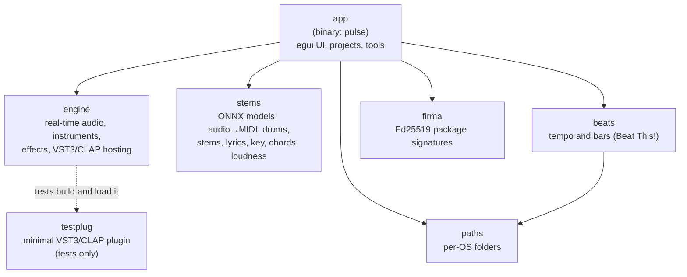
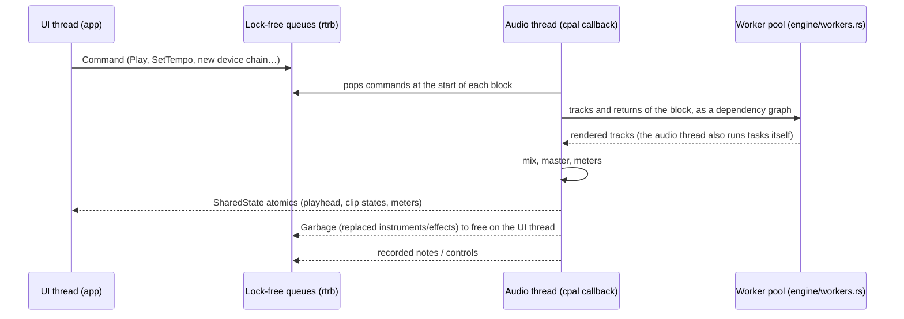

# Pulse architecture for contributors

This is a map of the code for someone opening it for the first time. To set up
the toolchain and run the tests, see [CONTRIBUTING.md](../CONTRIBUTING.md).
Every module starts with a `//!` comment that says what it does, and those
comments are the best next step after this page.

Size, for orientation (Rust lines under each crate's `src/`, 2026-11-04):
`app` ≈ 82k, `engine` ≈ 44k, `stems` ≈ 4.9k, `testplug` ≈ 1k, and
`beats`, `paths` and `firma` under 400 each.

## Crates and how they depend on each other

| Crate | Main external dependencies | Responsibility |
|---|---|---|
| `engine` | `cpal` (CoreAudio / WASAPI), `rtrb` (lock-free queues), `vst3`, `clap-sys`, `symphonia` (audio decoding), `rustfft` | Everything that makes sound. No UI code. |
| `app` | `eframe`/`egui` (wgpu), `midir` (CoreMIDI / WinMM), `rfd` (file dialogs), `serde_json`, `hound`, `roxmltree` (Ableton `.als`) | The `pulse` binary: the window, the project model, editors, recording, export, the updater, and the composing and mixing tools. |
| `stems` | `ort` (ONNX Runtime, pinned `=2.0.0-rc.14`, CPU only) | ML inference and audio analysis. |
| `beats` | `beat-this` (`rten`, pure Rust) | Tempo, beats and bars of an audio file. |
| `paths` | Win32 known folders on Windows | Where settings, data, caches and logs live (macOS, Windows and XDG rules). |
| `firma` | `ed25519-dalek` | Signs and checks Windows release zips. Also a small CLI (`pulse-firma`). |
| `testplug` | `vst3`, `clap-sys` | A tiny instrument/effect plugin used by the hosting tests. |

## Threads and the audio flow

- **The project lives on the UI side.** `crates/app/src/project.rs` is the
  source of truth. The engine receives copies. `crates/app/src/sync.rs`
  translates a project into engine `Command`s (`crates/engine/src/engine.rs`,
  `pub enum Command`), both for live playback and for offline rendering.
- **The UI talks to the engine only through a lock-free queue** (`rtrb`). It
  reads transport and clip state back through atomics in `SharedState`.
  `EngineHandle` (`crates/engine/src/audio.rs`) is the UI's end.
- **The audio thread must never allocate, lock or wait for the OS.** Anything
  the engine replaces (an instrument, an effect, a plugin) goes back to the
  UI thread as `Garbage`, and the UI thread frees it there.
  `crates/engine/tests/stress.rs` installs a counting global allocator and
  fails if the audio thread or its workers allocate. It passes on macOS and
  on Windows CI.
- **Multi-core.** `crates/engine/src/workers.rs` is a fixed pool of threads,
  started off the audio thread, that help render each block's tracks
  following their dependencies (sidechains, groups, returns). A late worker
  only means less help, never a late block. On Windows the pool raises each
  worker to the audio thread's priority as it creates it (a thread that had
  to raise itself might not run for seconds on a busy machine).
- **Determinism.** The audio engine is designed for deterministic rendering
  across buffer sizes and thread counts. Automated tests cover this
  behavior, including repeatability of offline renders (for example
  `threads_play_the_same_samples` and `any_callback_size_plays_the_same` in
  `stress.rs`, `what_plays_does_not_depend_on_the_buffer_size` in
  `crates/app/src/fidelity_tests.rs`). They cover the engine's own
  instruments and effects. Third-party plugins and the ML models (ONNX
  Runtime) are outside what these tests cover. On Windows x64, ONNX Runtime's
  activations differ in the last bits between thread counts; the notes are the
  same (`more_threads_give_the_same_notes` in `crates/stems/src/transcribe.rs`).
- **Offline rendering** (`crates/engine/src/offline.rs`, used by
  `crates/app/src/export.rs`) runs the same `Engine` without an audio device,
  faster than real time, on a background thread. `pulse --render out.wav
  [project.pulse]` uses it from the command line.

### Rules for code on the audio thread

If your change runs inside `Engine::process` (instruments, effects, mixer,
plugin processing, worker tasks):

1. No `Vec::push` beyond preallocated capacity, no `Box::new`, no `String`
   formatting, no `HashMap` insertion. Preallocate when the command is built
   on the UI thread.
2. No `Mutex`, no channel that can block, no file or network I/O, no logging.
3. Anything you replace goes back as `Garbage`.
4. Run `cargo test --release -p engine --test stress` and the buffer-size and
   thread-count tests before opening the PR.

## Plugins (VST3 and CLAP)

- `crates/engine/src/plugin.rs` hosts VST3 and `crates/engine/src/clap_host.rs`
  hosts CLAP. A plugin's module is loaded once per process. Each instance is
  split into a `PluginProcessor` (audio thread, preallocated buffers) and a
  `PluginHandle` (UI thread: parameters, state save/restore). Instances are
  created and dropped on the UI thread.
- **Scanning runs out of process.** Each bundle is loaded by
  `pulse --scan-plugin <bundle>` with a timeout (`plugins::scan_apart` in
  `crates/app/src/plugins.rs`), so a plugin that crashes during scanning
  doesn't take Pulse down.
- **Crash rescue** (`crates/app/src/plugin_guard.rs`). Pulse writes a note
  before loading a plugin, and a flight recorder says which plugin the audio
  thread is inside. After a crash, the next start offers to open the project
  without that plugin.
- **Editors** (`crates/app/src/editor.rs`) are embedded through NSView on
  macOS and HWND on Windows. Linux has stubs only.
- Every audio bus is active: an effect's second input is its sidechain, and
  an instrument's extra outputs can feed other tracks.
- Search folders: the standard VST3/CLAP locations on each OS, plus the ones
  added in Ajustes → Plugins.

## The UI

- `eframe`/`egui` with the wgpu renderer. `crates/app/src/app.rs` holds
  `PulseApp`, and each area has its own module: `session.rs`,
  `arrangement.rs`, `piano_roll.rs`, `devices.rs`, `browser.rs`,
  `returns.rs`, and so on. Shared look and feel is in
  `theme.rs` and `widgets.rs`.
- On macOS, a native menu bar (`native_menu.rs`) handles ⌘ shortcuts. On
  Windows they're read from the keyboard (Ctrl).
- **Interface language** (`i18n.rs`, `en.rs`). UI text is written in Spanish
  inside `tr("…")`, and `en.rs` pairs each one with its English version;
  `fill(tr("{} compases"), &[&bars])` fills templates. A text without a pair
  shows in Spanish. A test fails if a `tr` text has no English pair or a pair
  is left over. Test scripts and screenshots always run in Spanish. Tests that
  draw in English use `i18n::with(Language::English, || …)`.
- **UI tests without a window.** `PulseApp::headless(project)` plus
  `egui::Context::run_ui` with simulated input, and `crate::offscreen::Canvas`
  to render PNGs. `crates/app/src/readme_shots.rs` makes the README
  screenshots this way:
  `cargo test --release -p app readme_shots -- --ignored`.
- `PULSE_SCRIPT=<file>` (`script.rs`) drives the real app from a script.
  CI's Windows job uses it (`scripts/ci/arranque.txt`).

## Persistence and files

- **Projects** are `.pulse` files, JSON via `serde_json`. They carry a format
  number (`FORMAT` in `crates/app/src/project.rs`), and a Pulse that would
  lose data refuses a file from a newer format. Audio paths are stored
  relative to the project folder with `/`, so projects move between macOS
  and Windows (`crates/app/src/library.rs`).
- **Safe writes** (`crates/app/src/store.rs`). Each write goes to a temporary
  file, is flushed, then renamed into place. Unreadable files are set aside,
  never overwritten.
- **Autosave/recovery** is in `recovery.rs`, project **versions** in
  `versions.rs` (a `Versiones/` folder inside the project), and Ableton
  `.als` **import** in `als.rs`. MIDI files are in `midi_file.rs`.
- **Per-OS folders** come from `crates/paths` (table at the top of its
  `lib.rs`): settings, data (kits, models), caches, logs.

## Resources and models

| Resource | Where | How it ships |
|---|---|---|
| Basic Pitch (audio→MIDI), drum model | `crates/stems/models/*.onnx` | Built into the binary |
| Beat This! small model (tempo) | via the `beat-this` crate | Built into the binary (MIT) |
| HTDemucs (stems, 174 MB) | release `modelo-htdemucs-1` | Downloaded once, after asking; SHA-256 checked (`crates/app/src/stems_ui.rs`) |
| Whisper small (lyrics, 251 MB) | Hugging Face, pinned revision | Downloaded once, after asking; SHA-256 checked (`crates/app/src/lyrics_ui.rs`) |
| User guide | `docs/guia.md` | Built into the binary (`crates/app/src/guide.rs`) |
| Icon, Info.plist, Windows installer | `packaging/` | Used by `scripts/bundle.sh` and `scripts/package-windows.ps1` |
| Third-party licenses | `packaging/THIRD_PARTY_NOTICES.txt` | Generated by `scripts/notices.py`; a test checks it's current |

Model licenses and provenance are in `crates/stems/models/*_NOTICE` and in the
README's "AI models" section.

## Tests

About 1,280 `#[test]` functions. On 2026-11-04 on macOS, 1,196 passed and 84
were ignored (benchmarks, a 60-minute soak, tests that need large model
files).

| Kind | Examples |
|---|---|
| Sound | Instruments in tune, presets with headroom, effects matching their curves, exports identical to playback (`export_identity_tests.rs`) |
| Real-time safety | `crates/engine/tests/stress.rs` |
| Determinism | buffer size, thread count, repeated renders |
| UI | headless `PulseApp` with simulated input (`interfaz_tests.rs`, `*_tests.rs` in `crates/app/src`) |
| Persistence | `persist_tests.rs`: a rich project round-trips bit-identical |
| ML ports | `crates/stems`: Basic Pitch, pYIN, Whisper's log-mel and HTDemucs compared with the Python originals (some ignored: need the models) |
| Plugin hosting | `crates/engine/src/plugin.rs` and `plugin_io_tests.rs`, using `crates/testplug` |

## Build and release

- `rust-toolchain.toml` pins Rust 1.99.0. `--locked` pins dependencies.
- `.cargo/config.toml` sets `MACOSX_DEPLOYMENT_TARGET=13.4` and the Windows
  delay-load flags for DirectML.
- `Cargo.toml` has a `dist` profile (release plus line tables, split debug
  info) for published builds.
- macOS: `scripts/bundle.sh` → `Pulse.app`, and `scripts/release.sh`
  publishes it (maintainer only, needs the signing certificate). See
  [PUBLICAR.md](PUBLICAR.md).
- Windows: `scripts/package-windows.ps1` → portable zip + Inno Setup
  installer. See [BUILD_WINDOWS.md](BUILD_WINDOWS.md).
- CI: `.github/workflows/windows.yml` and `.github/workflows/macos.yml`. Both
  produce test artifacts only.
- The version comes from git tags (`git describe`), not from `Cargo.toml`
  (whose `0.1.3` is a placeholder). See `crates/app/build.rs`.
